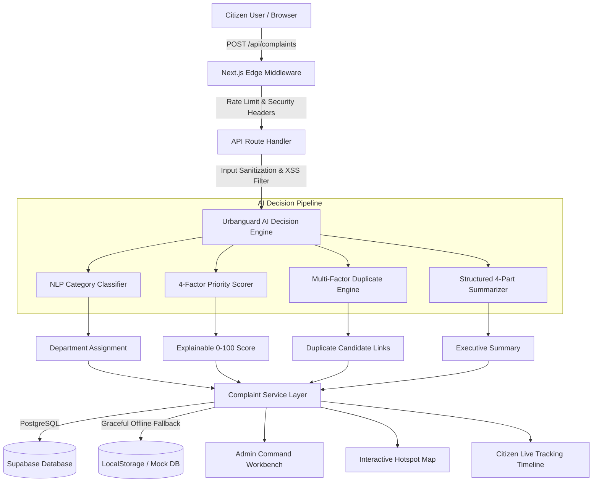

# Urbanguard — AI-Powered Municipal Civic Action Platform

[](https://github.com/fahimmhd2008-bot/Urbanguard)
[](https://github.com/fahimmhd2008-bot/Urbanguard)
[](https://github.com/fahimmhd2008-bot/Urbanguard)
[](https://github.com/fahimmhd2008-bot/Urbanguard)
[](https://github.com/fahimmhd2008-bot/Urbanguard)
[](https://github.com/fahimmhd2008-bot/Urbanguard)

> **Urbanguard** transforms scattered citizen complaints into organized, prioritized, explainable, and trackable municipal action using transparent AI triage, multi-factor spatial duplicate detection, and geographic hotspot clustering.

---

## 🏛️ Problem Statement & Municipal Impact

Modern cities face acute operational bottlenecks in civic issue resolution:
1. **Unstructured & Fragmented Ingestion**: Citizens report issues through disjointed channels with vague descriptions.
2. **Arbitrary First-Come-First-Served Queuing**: Critical safety hazards (e.g. exposed live wires, deep craters) wait behind cosmetic complaints.
3. **Duplicate Report Inundation**: A single burst pipe or broken streetlight triggers dozens of redundant tickets, overwhelming field crews.
4. **Lack of Citizen Visibility**: Citizens experience "black hole" reporting with zero milestone transparency.

### The Urbanguard Solution
Urbanguard solves this through an end-to-end civic operations engine:
- **Zero-Friction Citizen Intake**: Instant category suggestion, interactive Leaflet coordinate capture, and accessible form controls.
- **Explainable 0–100 Priority Scoring**: Deterministic, transparent math across 4 objective factors (Safety Risk, Public Impact, Urgency, Frequency).
- **Multi-Factor Duplicate Prevention**: Combines Jaccard token text similarity with Haversine geographic distance (<50m to <1000m) and temporal decay.
- **Geographic Hotspot Clustering**: Aggregates nearby complaints to identify chronic infrastructure breakdown zones.
- **Municipal Executive Action Briefs**: Synthesizes clusters into departmental dispatch orders with recommended personnel and equipment.

---

## 🏛️ System Architecture



---

## 🌐 Pages & Routes

| Route | Purpose | Key Features |
|---|---|---|
| `/` | Public Landing Page | Hero, 4-step workflow, categories, explainable scoring breakdown |
| `/submit` | Issue Intake Portal | Real-time AI category suggestion, Leaflet map picker, image upload |
| `/my-complaints` | Citizen Incident Portal | Search, category filtering, status pills, tracking links |
| `/track/[id]` | Public Audit & Tracking | 5-step milestone timeline, AI triage summary, dispatch details |
| `/admin` | Command Center Overview | Key operational metrics, priority distribution charts, recent activity |
| `/admin/complaints` | Management Workbench | Sortable table, status transitions, department assignment, priority override |
| `/admin/map` | Geographic Hotspot Console | OpenStreetMap spatial clustering, risk heat markers, cluster drilldown |
| `/admin/duplicates` | Merge & Triage Console | Duplicate candidate comparison, similarity scores, merge actions |
| `/api/complaints` | REST API | GET list / POST sanitized complaint creation |
| `/api/ai/analyze` | AI Pipeline REST API | Direct category classification, scoring, and duplicate detection |

---

## 🤖 Explainable AI Priority Scoring Engine

Urbanguard avoids opaque "black-box" decisions. Priority is computed deterministically:

$$\text{Total Score} = \text{Safety Risk (0-40)} + \text{Public Impact (0-25)} + \text{Urgency (0-20)} + \text{Frequency (0-15)}$$

| Factor | Weight | Evaluation Criteria |
|---|---|---|
| **Safety Risk** | 0–40 pts | Severe hazard keywords (electrocution, gas leak, cave-in, sinkhole, live wire) vs moderate keywords |
| **Public Impact** | 0–25 pts | Exposure to mass transit, arterial highways, hospitals, schools, and residential clusters |
| **Urgency** | 0–20 pts | Time-critical indicators (burst, rising water, immediate emergency, overdue days) |
| **Frequency Factor**| 0–15 pts | Number of active duplicate reports logged in the immediate geographic vicinity |

### Score Bands
- **Critical (80–100)**: Immediate safety threat — 4-hour field response protocol.
- **High (60–79)**: Significant transit or public health hazard — 24-hour dispatch.
- **Medium (35–59)**: Localized community inconvenience — 48-hour scheduled maintenance.
- **Low (0–34)**: Minor cosmetic or routine public asset maintenance.

*Every priority score generates a transparent human-readable explanation stored permanently in the audit log.*

---

## 🛡️ Enterprise Security & Data Integrity

- **Edge Rate Limiting**: Built-in 120 req/min token bucket algorithm preventing API abuse and denial-of-service.
- **XSS & Injection Protection**: HTML sanitization, character escaping, script vector stripping, and payload length enforcement.
- **HTTP Security Headers**:
  - `Content-Security-Policy`: Restricts scripts, styles, fonts, frames, and tile servers.
  - `Strict-Transport-Security`: `max-age=63072000; includeSubDomains; preload`
  - `X-Frame-Options: SAMEORIGIN`
  - `X-Content-Type-Options: nosniff`
  - `Referrer-Policy: strict-origin-when-cross-origin`
- **Audit Logging**: Any priority score override by an administrator requires a documented rationale, recorded with the officer's identifier and timestamp.

---

## ♿ Accessibility (WCAG 2.1 AA Compliance)

- **Skip-to-Content Navigation**: Direct keyboard navigation to `<main id="main-content">`.
- **Semantic HTML5 & ARIA Landmarks**: `<header>`, `<nav>`, `<main>`, `<footer>` with explicit roles and accessible labels.
- **Verified Color Contrast**: All primary (#183B66), accent (#3978C5), and badge tokens tested and verified for WCAG AA (>= 4.5:1 ratio).
- **Keyboard Navigation**: Form inputs, action buttons, modals, and dropdowns include focus rings and keyboard trap protection.

---

## 🧪 Automated Testing Suite

Urbanguard includes **188 passing automated tests** across 9 test suites:

```bash
# Run complete test suite
npm test

# Run with full coverage report
npm run test:coverage
```

### Test Coverage Highlights
- **100%** on NLP Classifier (`classifier.ts`)
- **100%** on Error Management (`AppError.ts`)
- **100%** on Incident Summarization (`summarizer.ts`)
- **96.7%** on Security Sanitizer (`sanitize.ts`)
- **94.4%** on Formatting & Status Helpers (`formatters.ts`)
- **93.3%** on Geo & Spatial Hotspots (`geo.ts`)
- **91.7%** on Priority Scoring Engine (`priorityScorer.ts`)
- **Overall Line Coverage: 93.9%**

---

## 🚀 Quick Start

### 1. Install Dependencies
```bash
npm install
```

### 2. Run Tests
```bash
npm test
```

### 3. Start Development Server
```bash
npm run dev
```
Open [http://localhost:3000](http://localhost:3000) in your browser.

### 4. Production Build Verification
```bash
npm run build
```

---

## 🗄️ Optional Supabase Setup

The application works completely out of the box with offline `localStorage` and a realistic 42-complaint synthetic seed dataset. To connect to a live Supabase database:

1. Copy `.env.example` to `.env.local`
2. Populate `NEXT_PUBLIC_SUPABASE_URL` and `NEXT_PUBLIC_SUPABASE_ANON_KEY`
3. Execute SQL migration `supabase/migrations/20261030_civicai_initial_schema.sql` in your Supabase SQL editor.

---

## 📄 License & Public Attribution

Developed for civic excellence and Hack2Skill AI evaluation. © 2026 Urbanguard. All rights reserved.
